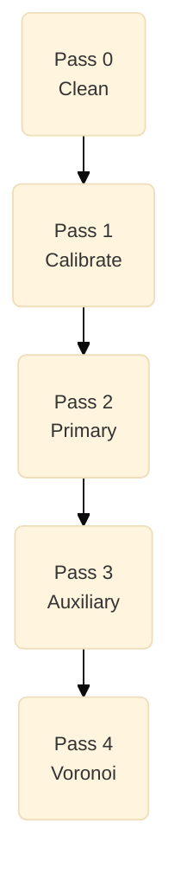

# ADR-00008: Cross-Group Weather Imputation DAG and Causal Anti-Leakage Governance

- **ADR ID**: ADR-00008
- **Filename**: `ADR-00008-weather-imputation-dag-and-anti-leakage-.md`
- **Date**: 2026-11-19 04:05 UTC
- **Status**: PROPOSED
- **Target Subsystem**: End-to-end weather imputation orchestration, cross-group dependency DAG, and forecast-origin leakage boundaries (`src/bayes_demand_fcst/`, `scripts/weather/`, `dvc.yaml`)
- **Linked Commits**: Pending acceptance

---

## 1. Context & Problem Statement
[`ADR-00003`](ADR-00003-spatiotemporal-kriging-group-a-weather--.md) (Group A: `tmpf`, `dwpf`, `relh`, `feel`), [`ADR-00004`](ADR-00004-spatiotemporal-kriging-group-b-pressure-.md) (Group B: `alti`, `mslp`), [`ADR-00005`](ADR-00005-bounded-interpolation-group-c-precip-vis.md) (Group C: `p01i`, `vsby`), [`ADR-00006`](ADR-00006-cloud-fraction-kriging-group-d-sky-cover.md) (Group D: `skyc1`, `skyl1` $\to$ `cloud_frac`), and [`ADR-00007`](ADR-00007-coastline-and-ercot-weather-zone-layers-.md) (auxiliary coastline and 8 ERCOT weather-zone spatial layers) specify domain-appropriate physics and interpolation math for each variable group. However, two cross-cutting architectural problems cannot be solved inside any single group ADR:

1. **Inter-Group Execution Dependencies**: Implementing Groups A–D as four standalone per-group scripts would scan 720 raw ASOS CSVs (~6.2 GB) repeatedly and fail on cross-group conditioning requirements (`ADR-00004` `delta_p` requires Group A `tmpf_12h`; `ADR-00005` `p01i` dry-`NaN` resolution requires raw `tmpf`/`alti` liveness; `ADR-00005` `vsby` fog suppression requires Group A `tmpf - dwpf` plus completed `p01i`; `ADR-00006` `cloud_frac` rain-cloud consistency requires completed `p01i`).
2. **Subtle Spatiotemporal Train/Test & Forecast-Origin Contamination**: Because downstream modeling targets probabilistic next-hour ($h = 1$) and next-day ($h = 24$) ERCOT demand forecasts benchmarked against ERCOT operational forecasts — plus extensible probabilistic figures of merit conditioned on weather and lagged fuel mix — two forms of temporal leakage must be prevented inside the weather ETL layer itself:
   - **Lookahead Neighborhood Contamination ($t_{\text{obs}} > t_0$)**: Two-sided temporal interpolation or space-time kriging around target hour $t_0$ (`HH:00 UTC`) ingests future observations (e.g., `15:53 UTC` when constructing the `15:00 UTC` feature vector used to forecast `16:00 UTC` demand), leaking unarrived cold fronts and storm passages across the forecast origin.
   - **Full-Archive Parameter Contamination**: Fitting station Fourier harmonic baselines $m_i(t)$, $\Delta P$ regression coefficients $(\beta_0, \beta_1, \beta_2)$, variogram hyperparameters $(\sigma^2, \ell_s, \ell_t, \sigma_{\text{nug}}^2)$, or station dry-omission `zero_rate` across the entire `2014–2025` archive leaks held-out validation/test-year statistics into historical and test-period covariates.

## 2. Decision Drivers & Constraints
- **Single Acyclic Execution Graph**: Read raw CSV archives once, satisfy every cross-group physical dependency in topological order without circularity, and keep peak memory bounded via windowed execution.
- **Zero Forecast-Origin Lookahead ($t_{\text{obs}} \le t_0$)**: Every weather covariate and uncertainty metric indexed at `timestamp_utc` $= t_0$ MUST be strictly constructible from observations valid at or before $t_0$ (`valid <= t_0`), preserving operational validity for $h = 1$, $h = 24$, and future probabilistic figures of merit.
- **Strict Train-Window Parameter Freezing**: All global/station-level statistical parameters used during weather imputation MUST be estimated strictly inside a configurable training calibration cutoff (`--train-end-utc`, e.g., `2021-12-31T23:00:00Z`, or expanding-window anchors) without refitting kriging per cross-validation fold.
- **Extensibility for Future Figures of Merit**: Preserve both causal operational features (`mode="causal"`, default) and optional explicitly labeled ex-post reanalysis diagnostics (if ever needed for oracle-weather sensitivity benchmarks) without conflating the two, while carrying station/zone kriging uncertainty forward for distributional GAMs.

## 3. Considered Alternatives & Rejection Rationale
- **Alternative A: Execute `ADR-00003`–`ADR-00006` as four independent per-group CLI passes over raw CSVs**. Rejected because it quadruples raw CSV I/O and forces awkward intermediate disk round-trips to pass `tmpf_12h`, `tmpf - dwpf`, and `p01i` between groups.
- **Alternative B: Allow two-sided (`t_obs` before and after `t_0`) interpolation as the default pipeline output**. Rejected because routine ASOS (`:51–:55`) and AWOS (`:15/:35/:55`) already provide fresh observations 5–7 minutes *before* `HH:00 UTC`; peeking 53 minutes *ahead* to `H:53 UTC` contaminates $h = 1$ next-hour forecasts and invalidates head-to-head comparisons against ERCOT's operational forecasts.
- **Alternative C: Re-run full 317-station kriging from scratch inside every downstream GAM cross-validation fold**. Rejected as computationally prohibitive (~`33.35M` station-hours per variable) and unnecessary once neighborhood lookups are strictly causal ($t_{\text{obs}} \le t_0$) and global drift/variogram parameters are frozen on the pre-validation training window.

## 4. Decision Outcome
Govern the implementation of [`ADR-00003`](ADR-00003-spatiotemporal-kriging-group-a-weather--.md)–[`ADR-00007`](ADR-00007-coastline-and-ercot-weather-zone-layers-.md) through a **unified 5-Pass Horizontal Execution DAG** paired with **two mandatory anti-leakage rules**:

### A. Unified 5-Pass Execution DAG
*(Prerequisite: [`ADR-00007`](ADR-00007-coastline-and-ercot-weather-zone-layers-.md) static spatial artifacts — `dist_coast_km`, `weather_zone`, `voronoi_weights.parquet`, and `voronoi_weights_by_zone.parquet` — are materialized first; static geography is time-invariant.)*

- **Pass 0 (Raw Ingestion & Cleaning)**: Single read of 720 CSVs; bounds QC, METAR `SLP` wrap filter, 12,000-ft ceilometer gate, okta encoding, algebraic `dwpf` prefill, and deduplication.
- **Pass 1 (Frozen In-Sample Calibration)**: Strictly on $t \le \text{train\_end\_utc}$: station Fourier harmonics (`tmpf`, `dwpf`, `alti`), global $\Delta P$ OLS, empirical variograms, and `p01i` `zero_rate`.
- **Pass 2 (Primary Hourly Cubes)**: Rolling 1-year windows with causal `-24h` lookback buffer: Group A (`tmpf`, `dwpf`, `feel_diff` $\to$ `relh`, `feel`, `tmpf_12h`), Group B1 (`alti`), Group C1 (`p01i` hurdle).
- **Pass 3 (Conditioned Auxiliary Cubes)**: Same 1-year window in RAM: Group B2 ($\Delta P \to \text{mslp}$), Group C2 (`vsby` + dry-air fog guard), Group D (`cloud_frac` + rain floor).
- **Pass 4 (Voronoi Spatial Aggregation)**: Statewide ERCT + 8 ERCOT weather zones: 9 regional features + `mslp_tendency_3h` and uncertainty summaries.

### B. Strict Causal Filtering Rule (`t_obs <= t_0`) — Default Operational Mode
For every target hour $t_0$ (`HH:00:00 UTC`) across `2014-01-01T07:00:00Z`–`2026-01-01T06:00:00Z`:
1. **Hard Causal Horizon**: All local temporal alignments and 3D space-time kriging / KNN neighborhoods in Passes 2 and 3 MUST restrict candidate observations strictly to **`t_obs <= t_0`** (using lookback lag $u = t_0 - t_{\text{obs}} \ge 0$ rather than two-sided $|t_{\text{obs}} - t_0|$).
   - *Superseding clarification on [`ADR-00003`](ADR-00003-spatiotemporal-kriging-group-a-weather--.md)–[`ADR-00006`](ADR-00006-cloud-fraction-kriging-group-d-sky-cover.md)*: Wherever individual group ADRs mention two-sided short brackets (`±40 min` or `±45 min`) or `±24h` rolling window buffers, operational causal mode replaces the future side with **one-sided causal lookback (`[t_0 - 60 min, t_0]` for short local alignment — naturally capturing `:15/:35/:51/:53/:55` reports inside hour-ending `(H-1, H]` — and `-24h` trailing window buffers at year boundaries)**.
   - Note on `ADR-00005` `p01i`: Because `:51–:55` routine METARs already precede `HH:00 UTC`, causal mode caps the cycle upper bound at `H:00 UTC` (`(H-1:00, H:00]` / routine `:51–:55` reading $\le t_0$) so post-`:00` reports never leak backward.
2. **Optional Non-Default Reanalysis Mode**: If two-sided smoothing is ever run for offline historical climatology or explicitly labeled "oracle-weather" sensitivity studies, it MUST require an explicit `--mode reanalysis` CLI flag, write to a separate artifact path, and NEVER overwrite the canonical causal `weather_station_hourly` / `weather_regional_hourly` DVC outputs.

### C. Training-Window Parameter Freezing (`--train-end-utc`)
1. **Calibration Cutoff**: Pass 1 MUST fit all global and per-station statistical parameters strictly on observations satisfying **`valid <= train_end_utc`** (defaulting to the end of the primary training period, e.g., `2021-12-31T23:59:59Z`, leaving `2022–2025` completely untouched for validation and final out-of-sample testing, and persisted in a JSON/Parquet parameter artifact tracked by DVC):
   - Station Fourier harmonic coefficients $(\alpha_i, c_{ik}, s_{ik})$ and sparse-station spatial fallback regressions (`ADR-00003`, `ADR-00004`).
   - Global barometric reduction OLS $(\beta_0, \beta_1, \beta_2)$ (`ADR-00004`).
   - Empirical space-time variogram hyperparameters $(\sigma^2, \ell_s, \ell_t, \sigma_{\text{nug}}^2)$ (`ADR-00003`–`ADR-00006`).
   - Station dry-precipitation omission rates `zero_rate` (`ADR-00005`).
2. **Frozen Forward Evaluation**: Passes 2 and 3 apply those frozen Pass 1 parameters unchanged across both in-sample (`<= train_end_utc`) and out-of-sample (`> train_end_utc`) years using strictly causal (`t_obs <= t_0`) observation neighborhoods, guaranteeing that every timestamp $t_0 > \text{train\_end\_utc}$ is a true zero-lookahead out-of-sample filter step.

### D. Preserving Rich Downstream Figures of Merit
Because every timestamp $t_0$ in the resulting panel satisfies $\mathcal{F}_{t_0}$-measurability (`valid <= t_0`), downstream Bayesian GAMs and decision analyses can evaluate **any** causal figure of merit from the same unified panel without rebuilding weather ETL:
- Next-hour ($h = 1$) and multi-step ($h = 1 \dots 24+$) predictive distributions (`CRPS`, log score, pinball loss, calibrated central/tail intervals);
- Head-to-head probabilistic skill vs. ERCOT operational load forecasts (separating pure $\mathcal{F}_{t_0}$ observational forecasts from explicitly labeled NWP / oracle-weather benchmarks);
- Conditional impact of lagged fuel-mix shares (`Wind`, `Solar`, `WSL` storage, thermal) and `cloud_frac` on demand location, scale (heteroscedastic spread), skewness, ramp rates, and extreme peak exceedance probabilities across ERCOT and its 8 weather zones.

## 5. Invariants & Guardrails
- **Strict Forecast-Origin Causality**: Canonical `weather_station_hourly` and `weather_regional_hourly` artifacts MUST NEVER incorporate any raw weather observation with `valid > timestamp_utc`.
- **No Test-Period Parameter Leakage**: No harmonic coefficient, regression weight, variogram parameter, or station missingness statistic may be estimated using rows with `valid > train_end_utc`; `train_end_utc` MUST be recorded in `quality_report.json` and `dvc.yaml` params/args.
- **Topological Pass Ordering**: Pass 2 (`tmpf`, `dwpf`, `feel_diff`, `alti`, `p01i`) MUST complete on each window before Pass 3 (`delta_p`/`mslp`, `vsby`, `cloud_frac`) executes.
- **Contemporaneous Fuel-Mix & Future-Weather Separation**: Downstream forecasting models at origin $t_0$ predicting $y_{t_0 + h}$ ($h \ge 1$) MUST NOT consume realized weather $\mathbf{w}_{t_0 + h}$ or realized fuel mix $\mathbf{q}_{t_0 + h}$ unless explicitly flagged and reported as an ex-post oracle-covariate benchmark.

## 6. Consequences & Downstream Impact
- **Positive / Guarantees**: Unifies `ADR-00003`–`ADR-00007` into one single-read, bounded-memory 5-pass engine; guarantees zero lookahead contamination at every hour $t_0$ for both $h = 1$ and $h = 24$ forecasting; eliminates costly per-CV-fold kriging recomputation; keeps the feature store extensible to new probabilistic figures of merit and fuel-mix uncertainty studies.
- **Negative / Trade-offs**: One-sided causal filtering (`t_obs <= t_0`) has slightly higher kriging variance during multi-hour station outages than two-sided reanalysis smoothing (a feature rather than a bug, as it matches real-time operational uncertainty and is captured directly in $\sigma^2_{\text{krig}}$); any future change to `train_end_utc` requires re-running Pass 1–Pass 4 via DVC.
